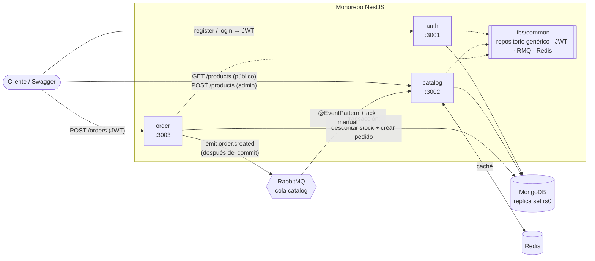

# mini-ecommerce

E-commerce multi-servicio construido como **monorepo NestJS**: autenticación, catálogo y pedidos como
microservicios independientes que comparten una librería común, con **MongoDB** (transacciones),
**RabbitMQ** (eventos con ack manual), **Redis** (caché con invalidación por evento), **Docker** y
**GitHub Actions** con filtro por rutas.

> Fase 1 = backend. La fase 2 agrega el frontend **Angular 19 SSR** (ver [Roadmap](#roadmap)).

## Arquitectura



### Flujo de un pedido

1. El cliente hace `POST /orders` con su JWT. `order` valida el token **localmente** (secreto compartido),
   sin llamar a `auth`.
2. Dentro de **una transacción de MongoDB**, por cada línea se ejecuta un `findOneAndUpdate` con la
   condición `stock >= cantidad` y `$inc: { stock: -cantidad }`. Condición y descuento son atómicos: dos
   pedidos no pueden vender la última unidad. Si una línea no alcanza, se lanza `409` y la transacción
   **revierte** el stock ya descontado de las líneas anteriores.
3. El pedido se guarda con un **snapshot** de nombre, SKU y precio de cada producto: si el precio cambia
   mañana, el pedido histórico no cambia.
4. **Después del commit** se publica `order.created` en RabbitMQ. Publicar antes del commit podría avisar
   de un pedido que luego se revierte.
5. `catalog` consume el evento con `noAck: false`: invalida en Redis el detalle de esos productos, sube la
   versión de los listados y recién entonces hace `ack`. Si algo falla hace `nack` sin reencolar, para no
   entrar en un bucle con un mensaje que siempre falla.

### Decisiones de diseño

| Tema | Decisión | Por qué |
|---|---|---|
| Monorepo | Nest CLI (`apps/*` + `libs/common`, alias `@app/common`) | Un repo, servicios desplegables por separado, código compartido sin publicar paquetes |
| Repositorio | `AbstractRepository<T>` genérico: CRUD, `paginate` (página + conteo en paralelo), `withTransaction` | Cada servicio hereda el acceso a datos y solo agrega consultas propias (`StockRepository.reserve`) |
| Transacciones | `connection.transaction()` de Mongoose | Reintenta solo ante errores transitorios (`WriteConflict`) en pedidos concurrentes |
| Auth | JWT HS256 validado en cada servicio con `passport-jwt`; `RolesGuard` + `@Roles()` | Sin llamada de red a `auth` por cada request |
| Caché | Claves versionadas para listados (`catalog:list:v{n}:…`) + borrado del detalle | Invalidar "todos los listados" es un `INCR`, sin `KEYS *`; las claves viejas mueren por TTL |
| Resiliencia | Un Redis caído se trata como *miss*; un RabbitMQ caído no rompe el pedido (timeout de 5 s y log) | La fuente de verdad es MongoDB; la caché y el evento son secundarios |
| Configuración | `ConfigModule` + **Joi** por app (esquema base + extras) | El servicio no arranca con una variable faltante o mal formada |
| Validación | `ValidationPipe` global con `whitelist` y `forbidNonWhitelisted`; `ParseObjectIdPipe` | Campos desconocidos → 400; id mal formado → 400 y no 500 |
| Borrado | Lógico (`active: false`) en productos | Los pedidos históricos siguen apuntando a un producto existente |

### Índices

| Colección | Índice | Consulta que lo usa |
|---|---|---|
| `users` | `{ email: 1 }` único | Login y control de correo duplicado |
| `products` | `{ sku: 1 }` único | Evita SKU duplicados (se traduce a `409`) |
| `products` | texto `{ name, description }` con peso 3 a 1 | `GET /products?search=` |
| `products` | `{ active: 1, category: 1, price: 1 }` | Listado público filtrado por categoría |
| `orders` | `{ userId: 1, createdAt: -1 }` | "Mis pedidos" paginado y ordenado por fecha |

## Estructura

```text
apps/
  auth/      registro, login, /auth/me, admin semilla
  catalog/   productos, búsqueda, caché Redis, consumidor de order.created
  order/     pedidos, transacción de stock, publicación de order.created
libs/common/
  database/  AbstractRepository, AbstractDocument, DatabaseModule
  auth/      JwtStrategy, JwtAuthGuard, RolesGuard, @Roles, @CurrentUser
  rmq/       RmqModule.register({ name }), RmqService (ack / nack)
  redis/     cliente ioredis global
  models/    esquema Product compartido por catalog y order
  events/    contrato OrderCreatedEvent y nombres de eventos
.github/workflows/
  _service.yml            pipeline reutilizable (lint → tests → build → imagen Docker)
  auth.yml, catalog.yml, order.yml   disparados solo por cambios en su app o en libs/
```

## Cómo correrlo

### Con Docker (todo el sistema)

```bash
docker compose up --build
```

Levanta MongoDB (replica set de un nodo, se inicializa solo), Redis, RabbitMQ y los tres servicios.
Se crea un admin semilla `admin@mini-ecommerce.dev` / `Admin123!` (cambiar con `ADMIN_EMAIL`,
`ADMIN_PASSWORD` y `JWT_SECRET` en un `.env` junto al `docker-compose.yml`).

| Servicio | URL |
|---|---|
| Auth (Swagger) | http://localhost:3001/docs |
| Catalog (Swagger) | http://localhost:3002/docs |
| Order (Swagger) | http://localhost:3003/docs |
| RabbitMQ (panel) | http://localhost:15672 (guest / guest) |

### Prueba rápida de punta a punta

El archivo [`docs/api.http`](docs/api.http) trae el recorrido completo (sirve con REST Client de VS Code
o JetBrains). En resumen:

```bash
# 1. Token de admin
curl -s -X POST localhost:3001/auth/login -H "content-type: application/json" \
  -d '{"email":"admin@mini-ecommerce.dev","password":"Admin123!"}'

# 2. Crear un producto (con el token de admin)
curl -s -X POST localhost:3002/products -H "authorization: Bearer <TOKEN>" -H "content-type: application/json" \
  -d '{"name":"Café 500 g","sku":"CAF-500","category":"cafe","price":189.5,"stock":10}'

# 3. Hacer un pedido (cualquier usuario registrado)
curl -s -X POST localhost:3003/orders -H "authorization: Bearer <TOKEN>" -H "content-type: application/json" \
  -d '{"items":[{"productId":"<ID_PRODUCTO>","quantity":2}]}'
```

En los logs de `catalog` aparece `Pedido … caché de 1 producto(s) invalidada` y el stock baja a 8.

### En local (sin contenedores para las apps)

```bash
npm ci
docker compose up -d mongo redis rabbitmq
cp apps/auth/.env.example apps/auth/.env        # igual para catalog y order
npm run start:auth      # en otra terminal: start:catalog, start:order
```

Las apps fuera de Docker se conectan a Mongo con `directConnection=true` (el replica set se anuncia como
`mongo:27017`, nombre que solo existe dentro de la red de Docker).

## Tests

```bash
npm test            # 36 tests, ~15 s
npm run test:cov    # con cobertura
npm run lint
```

| Archivo | Qué prueba |
|---|---|
| `orders.transaction.spec.ts` | **Integración contra MongoDB real** (replica set en memoria): el pedido descuenta stock; si la 2.ª línea no alcanza se revierte la 1.ª; dos pedidos concurrentes por la última unidad → solo uno gana; paginación |
| `orders.service.spec.ts` | Snapshot de precios y redondeo, evento publicado **después** del commit, 409 sin evento, RabbitMQ caído no rompe el pedido, dueño vs admin |
| `auth.service.spec.ts` | Hash bcrypt, correo en minúsculas, 409 por duplicado, 401 genérico, payload del JWT, admin semilla |
| `products.service.spec.ts` | Cache hit/miss, filtro de texto y categoría, 409 por SKU, PATCH parcial |
| `product-cache.service.spec.ts` | Claves versionadas, Redis caído = miss, invalidación en `MULTI` |
| `order-events.controller.spec.ts` | `ack` cuando se procesa, `nack` sin `ack` cuando falla |
| `roles.guard.spec.ts`, `parse-object-id.pipe.spec.ts` | Guard por rol y pipe de ObjectId |

## CI/CD

Cada servicio tiene su workflow con filtro `paths:`. Un cambio en `apps/catalog/**` solo corre el
pipeline de catalog; un cambio en `libs/**` corre los tres. El pipeline es un **workflow reutilizable**
(`_service.yml`): `npm ci` → lint → tests de la app y la librería → `nest build` → imagen Docker
multi-stage con caché de capas de GitHub Actions.

Los Dockerfiles son multi-stage: `deps` (npm ci) → `build` (`nest build <app>`, webpack empaqueta app y
librería en un solo `main.js`) → `runtime` (Node 20 Alpine, solo dependencias de producción, usuario
`node`, `HEALTHCHECK` contra `/health`).

## Stack

NestJS 10 · TypeScript 5 · MongoDB 7 / Mongoose 8 · RabbitMQ 3.13 (`@nestjs/microservices`) ·
Redis 7 (ioredis) · Passport JWT · class-validator · Joi · Swagger · Jest + mongodb-memory-server ·
ESLint + Prettier · Docker · GitHub Actions.

## Roadmap

- **Fase 2 — Frontend:** Angular 19 standalone con SSR (render por ruta), carrito con store, checkout con
  formularios reactivos e interceptor funcional con manejo de 401.
- **Mensajería:** servicio `email` que consume `order.created`, reintentos con dead-letter queue y
  *outbox pattern* para no perder el evento si RabbitMQ cae justo después del commit.
- **Datos:** pipelines de agregación (ventas por categoría, top productos), Atlas Search, esquemas en
  paquete npm versionado.
- **Auth:** refresh tokens, sesión persistida, rate-limit con Redis, login social.
- **Plataforma:** worker `order-cron` (pedidos pendientes vencidos), Socket.io para el estado del pedido,
  despliegue GitOps (Kustomize + ArgoCD) a un clúster local con kind.

## Licencia

MIT
